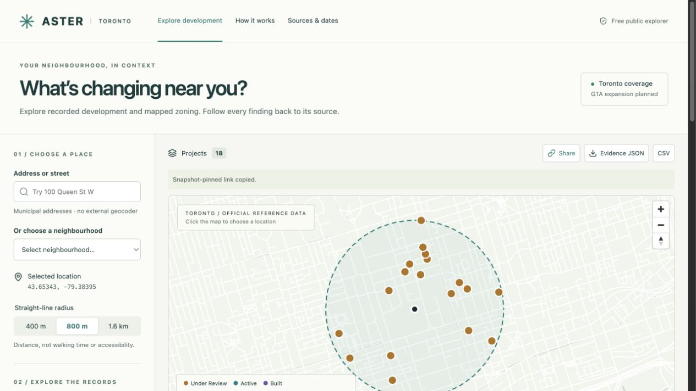
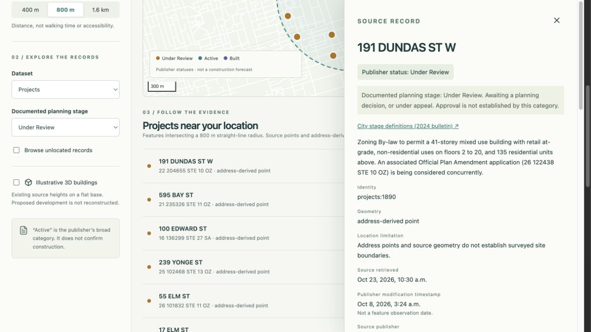
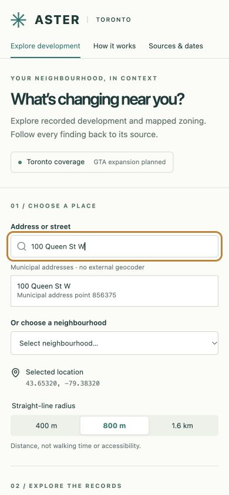

# ASTER in 90 seconds

A self-guided demonstration of the working public explorer. These are real application screenshots and reproducible queries, not proposed buildings or simulated planning records.

[Open the saved demonstration](https://kvishal1012.github.io/aster-neighbourhood-explorer/#snapshot=817447cb12a48dba75bb&lon=-79.3839500909972&lat=43.6534286150659&radius=800&kind=projects&stage=Under+Review&unlocated=0&text=). It retains the October 23, 2026 snapshot even after later updates.

## Walkthrough

| Time | Action | What to explain |
|---|---|---|
| 0–15 s | Open the explorer, search **100 Queen St W**, and choose municipal address point **856375**. | Search uses Toronto municipal address records. The selected address is a location, not a development-site boundary. On a narrow screen, the map loads only when requested. |
| 15–30 s | Keep **800 m**, choose **Projects**, then **Under Review**. | This saved snapshot returns **18 source records** intersecting a straight-line radius. This is not walking accessibility. |
| 30–50 s | Select **191 DUNDAS ST W**. | Read its original status, source dates, source identifier and official link. Under Review does not establish approval. Active does not confirm construction. |
| 50–65 s | Close evidence and switch to **Zoning areas**. Inspect a record. | Mapped zoning is informational. Dataset notes and official sources must be consulted; the application does not calculate legal development entitlement. |
| 65–80 s | Switch back to **Projects**, select **All stages**, then enable **Browse unlocated records**. | Unmatched or ambiguous locations remain searchable but are excluded from radius calculations. They are citywide records, not nearby results. |
| 80–90 s | Disable unlocated browsing, choose **Under Review**, then use **Share** and **Evidence JSON** or **CSV**. | Sharing pins the query to its snapshot. Exports retain source identities, original statuses and the calculation context. |

Applications are a separate view. Their original statuses are preserved; the normalized planning stage is Unknown until definitions are qualified. Application rows must not be added to project totals.

## Actual interface

Desktop map at the saved public query, captured October 23, 2026:

Source inspection for 191 Dundas St W, captured October 23, 2026:

Mobile address search at 390 × 844, captured from the local release preview on October 22, 2026. This is a desktop browser viewport, not a physical-device test:

These walkthroughs are developer verification. No independent resident study or measured civic-impact finding is claimed. See [VALIDATION.md](VALIDATION.md) and the optional [feedback guide](FEEDBACK.md).
